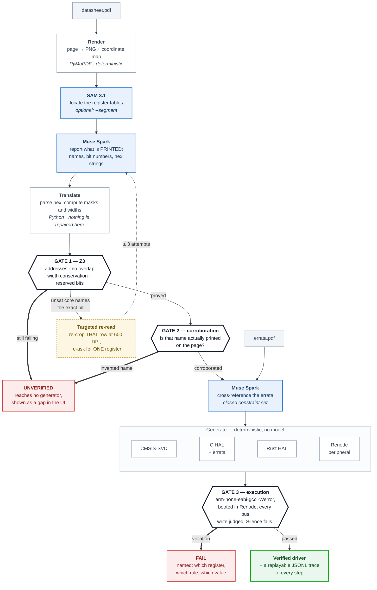

# SiliconTruth

**Datasheet + errata PDF → a driver proved correct in hardware emulation.**

SiliconTruth reads a chip's reference manual and its silicon errata sheet and emits a
verified hardware support package: a schema-valid CMSIS-SVD register map, a compiling
C and Rust HAL with errata workarounds injected, a Renode virtual peripheral, and a
test suite. Every register offset and bitfield is **proved by a Z3 SMT solver** before
any code is generated, and every generated driver is **executed inside headless Renode**
with its MMIO bus trace asserted against the datasheet's state machine.

> 🔗 **Try it with no API key:** `TODO: keyless replay link`

---

## The invariants

1. **No model output reaches code generation without passing every gate.**
2. **No generated code is claimed correct without executing in Renode.**
3. **A gate may only ever take verification away, never restore it.**

Everything else in this repo is plumbing around those three.

The third one reads like bookkeeping and is not. `audit()` used to set a
register's `verified` flag purely from its own result, so re-running it on
an IR loaded from disk silently re-verified a register a *different* gate
had rejected — and the build then emitted a full SVD and C HAL from an IR
whose every register was marked UNVERIFIED. Marking is now monotonic
downward, with regression tests.

---

## Why not just paste the PDF into a chatbot

- Text extraction **merges and destroys** the columns of dense 32-bit bitfield tables.
  The structure *is* the information.
- LLMs do **hex arithmetic badly** and return `base + offset` values that are off by 4.
- The **errata sheet is a separate document.** The register description on page 412 is
  *wrong* unless cross-referenced with the workaround on page 19. Chunked vector RAG
  severs exactly that link.

A wrong bit offset writes to the wrong control register. On a PMIC, that destroys the board.

---

## Status

| Component | State |
|---|---|
| `PeripheralIR` schema (the contract) | done, tagged `schema-v1` |
| Z3 verification gate (arithmetic) | done: 10/10 corruptions caught, ~20 ms |
| Name corroboration gate (invented fields) | done: closes a measured false negative |
| Z3 retry loop (600 DPI re-crop, 3 tries, then UNVERIFIED) | done |
| PDF render + coordinate spans | done: DPI round-trip tested |
| Page -> IR extraction (Muse Spark) | done: 20/20 fields exact on the fixture |
| Errata cross-reference + closed-set guardrails | done: 3/3 linked, 0 spurious |
| CMSIS-SVD emitter + structural validation | done |
| C HAL emitter + errata injection | done: 5/5 errata constraints |
| Renode peripheral + platform + script | done |
| MMIO oracle (trace parse + verdict) | done: keystone gate passes both ways |
| `/goal` acceptance gate | done: exit codes verified |
| CLI (`pipeline`/`extract`/`verify`/`build`/`emulate`/`oracle`/`replay`/`doctor`) | done |
| `pipeline`: one command, PDF to emulated driver | **done: PDF in, 7 artifacts out, 1 run** |
| Run recorder to JSONL fixtures | done |
| Next.js 15 workbench, keyless replay | done: prerendered (SSG) |
| Workbench UI, rebuilt on shadcn/ui in plain language | done: every number read from the run |
| Upload-your-own-PDF, run live in the browser (`/live`) | **done: driven end to end** |
| Light-only UI | **done: no dark theme, no toggle** |
| Naive-LLM baseline comparison | done: same model, same pages, no gate |
| SAM 3.1 table segmentation | done: `extract --segment`, 27 tests |
| Grid-column corroboration gate | done: closes the relabeling gap |
| 5-chip synthetic benchmark suite | done: 118/118 fields, 7/7 errata |
| Source-page pane with region overlays | done: prerendered, clickable |
| Modal verification container | written + unit-tested, not deployed |
| Local Docker verification container | **done: built and executed** |
| Test firmware + linker script (the missing ELF) | **done: 14 tests** |
| `arm-gcc -Werror` compile + Renode execution | **done: `emulate` runs the gate, live** |
| `svd2rust` (Rust half) | still Modal-only |
| Rust HAL emitter (`no_std`, errata-aware) | done: 17 tests |
| Muse Code 4-worktree fan-out | not started |

**333 tests pass** (extractor 32, oracle 32, text corroboration 28, segmenter 27,
errata linker 26, hal-c 23, z3 23, svd 19, modal 19, hal-rust 17, grid 17,
retry 15, test firmware 14, pdf 14, orchestrate 11, provider 10, recorder 6).
Everything except the extraction commands runs with no credentials; `emulate`
additionally needs Docker.

### What runs end to end, today

```bash
# PDF -> IR, with the Z3 gate run before anything is written
silicontruth extract benchmarks/synthetic/synthetic_usart.pdf \
    --pages 1 --chip synthetic --peripheral USART1 --base 0x40011000 \
    --errata benchmarks/synthetic/synthetic_errata.pdf -o out/ir.json

# IR -> SVD + C HAL + Renode model
silicontruth build out/ir.json -o out/synthetic

# Build the verification container once (Debian + arm-none-eabi-gcc + Renode)
docker build -f silicontruth/oracle/Dockerfile \
    -t silicontruth-oracle:1.15.3 silicontruth/oracle/

# Compile the driver with -Werror and run it in Renode. The keystone gate.
silicontruth emulate out/ir.json
```

Measured on the committed fixture: 21 fields read, Z3 pass, SVD valid,
3 of 3 errata linked with 0 spurious, and every generated mask matching
ground truth exactly.

`emulate` on the `uart32` fixture, run live:

```
compile PASS
WRITE 0x40011000 -> 0x00000000 [PASS]
WRITE 0x40011004 -> 0x00000000 [PASS]
WRITE 0x4001100C -> 0x00000000 [PASS]
emulate PASS: 3 MMIO transactions, no violations (1 check(s) not observable: CLOCK_ENABLE_BEFORE_ACCESS)
```

### Measuring against a known answer

Real reference manuals are copyrighted and cannot be committed, which makes
them useless as a CI fixture. `scripts/make_synthetic_datasheet.py` draws a
page in the visual idiom of an ST reference manual and emits the
ground-truth IR beside it, so accuracy has a denominator. Its generator
asserts the drawn bit grid covers bits 0..31 exactly once -- it did not at
first, which would have silently invalidated every number measured against
it.

## Architecture



### Where a model is asked anything, and what it is asked

Blue boxes are the **only** three places a model is involved. Everything else —
both corroboration gates, all four generators, the Renode oracle — is
deterministic Python, and that split is the design rather than an accident.

| Stage | What it is asked | What it is **never** asked | What happens to its answer |
|---|---|---|---|
| **SAM 3.1** | Where are the table regions on this page? | What the tables mean | A bounding box. A wrong box costs a re-crop, never a wrong number. |
| **Muse Spark** (registers) | What is *printed* here: names, bit numbers, hex strings | Any arithmetic. Not `base + offset`, not a mask, not a width | Parsed in Python, then it must survive Z3 and corroboration before a generator sees it |
| **Muse Spark** (errata) | Which workaround applies to which register | To invent a constraint | Matched against a **closed set**; anything outside it is rejected, never coerced |

**The repair loop is the one autonomous thing here.** When Z3 fails it does not
say "the IR is wrong somewhere" — the unsat core names the exact bit, that bit
maps back to a page and a bounding box, and those coordinates drive a 600 DPI
re-crop of that single table row. The model is asked again about one register,
with better pixels. Three attempts, then the register is marked UNVERIFIED and
excluded. That specificity is what the unsat core buys.

**The generators are deliberately not agentic, and that is load-bearing.** The
plan called for fanning codegen out across four agent worktrees. They are
deterministic pure functions over the IR that finish in single-digit
milliseconds, so there is nothing to parallelise — but the real reason is that
putting an agent between the verified IR and the emitted code would put a model
back inside the trusted region, which is exactly what the two gates exist to
prevent. See [Deliberate deviations](#deliberate-deviations-from-the-plan).

<details>
<summary>The same pipeline as plain text, with the module names</summary>

```
  datasheet.pdf          errata.pdf
        |                     |
        v                     v
  +---------------------------------------+
  | 1. INGEST            pdf_render.py     |   PyMuPDF. Renders at a chosen
  |    page -> PNG + coordinate spans      |   DPI and keeps the mapping
  +---------------------------------------+   between PDF points and pixels,
        |                                      so any region can be re-cropped.
        v
  +---------------------------------------+
  | 2. PERCEIVE          extractor.py      |   Muse Spark reads the page and
  |    image -> printed values ONLY        |   reports only what is PRINTED:
  +---------------------------------------+   names, bit numbers, hex strings.
        |                                      It is asked for no arithmetic.
        v
  +---------------------------------------+
  | 3. TRANSLATE         extractor.py      |   Python parses the hex, computes
  |    strings -> PeripheralIR             |   widths and masks, and fills in
  +---------------------------------------+   provenance from crop metadata.
        |                                      Nothing is repaired here.
        v
  +=======================================+
  | 4. PROVE          z3_register_audit.py |   <-- THE GATE
  |                                        |
  |    (a) abs_addr == base + offset,      |   Four constraints per register.
  |        4-byte aligned                  |   On failure the unsat core names
  |    (b) no two fields overlap           |   the exact bit, which drives a
  |    (c) SUM(widths) == width in {8,16,32}|  600 DPI re-crop of that one row
  |    (d) reset & reserved_mask == 0      |   (3 tries, then UNVERIFIED).
  +=======================================+
        |                                      An UNVERIFIED register reaches
        | only verified registers pass         NO generator. Enforced at all
        v                                      three emit boundaries, each
  +---------------------------------------+   with its own test.
  | 5. CROSS-REFERENCE   errata_linker.py  |
  |    errata page -> ErrataRule           |   Closed constraint set. Anything
  |    (closed set; prefix-checked)        |   outside it is REJECTED, never
  +---------------------------------------+   coerced. The register must also
        |                                      belong to THIS peripheral --
        v                                      SPI2_CR1 is not USART1's CR1.
  +---------------------------------------+
  | 6. GENERATE                            |
  |    svd_emitter      -> CMSIS-SVD       |   Errata become real code: a
  |    hal_c_emitter    -> C HAL + errata  |   delay loop, a guarded setter
  |    renode_peripheral-> Python model    |   that refuses the forbidden
  +---------------------------------------+   write, a clock hook that fails
        |                                      at link time if unimplemented.
        v
  +=======================================+
  | 7. EXECUTE        modal_app.py         |   <-- THE SECOND GATE
  |    arm-none-eabi-gcc -Werror           |
  |    renode --disable-xwt                |   Compiled by a real toolchain,
  |    renode_oracle: judge the MMIO trace |   run on a real emulator, and the
  +=======================================+   bus trace asserted line by line.
        |                                      Silence counts as failure.
        v
   verified HSP + a replayable JSONL trace of every step
```

</details>

**The gates are the whole design.** Gate 1 means no model output reaches a
generator unproved; gate 3 means no generated code is called correct
unexecuted. Everything between them is plumbing.

---

## Benchmarks

```bash
python scripts/make_benchmark_suite.py   # draw the pages + ground truth
python scripts/run_benchmarks.py         # score the pipeline against them
```

**These five chips are SYNTHETIC.** Real reference manuals are copyrighted
and cannot be committed, so there is no real-silicon scorecard and none is
claimed. These pages are drawn by `silicontruth/bench/synthetic.py` and read
by the same project, which makes them a *regression instrument*, not
evidence. Each stresses something different: 32-bit multi-column fields,
16-bit registers, 8-bit registers in a single bank, reserved runs in the
middle of a register, and a write-order dependency.

| chip | fields | offsets | resets | Z3 | names | grid | errata |
|---|---|---|---|---|---|---|---|
| `uart32` | 39/39 | 3/3 | 3/3 | pass | pass | pass | 2/2 |
| `timer16` | 18/18 | 2/2 | 2/2 | pass | pass | pass | 1/1 |
| `gpio8` | 24/24 | 3/3 | 3/3 | pass | pass | pass | 1/1 |
| `pmic32` | 8/8 | 2/2 | 2/2 | pass | pass | pass | 2/2 |
| `adc32` | 29/29 | 2/2 | 2/2 | pass | pass | n/a | 1/1 |
| **total** | **118/118** | **12/12** | **12/12** | — | — | — | **7/7, 0 spurious** |

`adc32` shows `n/a` for the grid check, not a failure: two long field names
sit close enough that the tokenizer returns them as one run, so the check
**abstains** rather than guess which half belongs to which column.

**0 false negatives** — no chip had a wrong read that the gates passed.
`run_benchmarks.py` exits non-zero if one ever does, because that single
result would invalidate the project's claim.

### The run that found three false positives

The first run of this suite reported `gpio8` failing Z3 and `adc32` failing
the grid check, on reads that were **entirely correct**. All three were bugs
in the gates, not the reads:

- Z3's alignment rule was a flat 4 bytes, so an 8-bit port with registers at
  offsets `0x00`/`0x01`/`0x02` failed. Alignment is now relative to the
  register's own width.
- The errata linker rejected `PORT_IDR` against peripheral `PORTB` as
  belonging to a different block, dropping a mandatory workaround. Instance
  suffixes are not always digits.
- Grid corroboration read `DEEPPWD` and `ADVREGEN` as one merged token and
  reported two disagreements. It now abstains.

A gate that rejects a correct read is worse than one that misses a wrong
one: it blocks working output and teaches whoever is watching to ignore it.

### The fixture with committed ground truth

| Measurement | Result | Source |
|---|---|---|
| Fields read exactly (name, msb, lsb) | 118/118 | each chip's `ground_truth.json` |
| Generated masks matching ground truth | 20/20 | `out/synthetic/usart1_hal.h` |
| Z3 gate latency | ~20 ms, 1 register | `pytest tests/test_z3_corruptions.py` |
| Deliberate corruptions caught | 10/10 | `tests/test_z3_corruptions.py` |
| Read stays exact down to | 60 DPI | `scripts/dpi_sweep.py` |
| Wrong reads below that, all caught | 3/3 | `benchmarks/synthetic/dpi_sweep.json` |

## Naive LLM vs SiliconTruth

```bash
python scripts/naive_baseline.py --trials 3
```

The baseline is deliberately **not** a straw man. It gets the same model,
the same page images at the same DPI, the errata document in the same
request, and a prompt that explicitly asks for correct masks and for errata
workarounds to be applied. The only thing withheld is SiliconTruth itself:
no Z3 gate, no width conservation, no closed constraint set, no execution.
The exact prompt is `PROMPT` in that file.

**The result does not say what it would be convenient for it to say.**

| | Masks correct | Errata cited |
|---|---|---|
| Naive, trial 1 | 20/20 | 3/3 |
| Naive, trial 2 | 20/20 | 3/3 |
| Naive, trial 3 | 20/20 | **0/3** |
| SiliconTruth | 20/20 | 3/3 |

On this clean synthetic page the naive approach reads every mask
correctly, so **this fixture does not demonstrate that verification
improves accuracy**, and it is not presented as if it did.

(An earlier version of the scorer reported the baseline at 5%. That was a
bug in the scorer, not a finding: it read `#define EOBIE_MASK (0x1U <<
EOBIE_SHIFT)` as the value `0x1` and scored it against `0x10000000`. A
baseline measured with a broken scorer is a straw man, so `extract_macros`
now resolves macro references and evaluates the expression.)

What the comparison *does* show is **variance**. Trial 3 silently dropped
all three mandatory errata workarounds on input identical to trials 1 and
2. From the generated C alone, that run is indistinguishable from the two
that got it right -- and nothing in the naive path tells you which kind of
run you just had.

So the claim this project defends is **detectability, not raw accuracy**:

- width conservation names the exact wrong bit *before* any code is
  generated (10/10 on deliberate corruptions), and
- the Renode oracle fails a driver that omits a workaround at execution
  time (`tests/test_renode_oracle.py`, and the keystone gate).

Neither requires a human to notice.

---

## Quickstart

Everything below except the two `extract` commands runs with **no
credentials**.

```bash
pip install -e ".[dev]"
pytest                                 # 333 tests
python -m silicontruth.cli doctor      # what is installed, what is missing
```

Draw the benchmark pages and generate a driver from one, end to end:

```bash
python scripts/make_benchmark_suite.py           # 5 synthetic chips + ground truth
cp .env.example .env                             # then fill in MODEL_API_KEY

python -m silicontruth.cli extract     benchmarks/suite/uart32/datasheet.pdf     --pages 1 2 3 --chip uart32 --peripheral USART1     --base 0x40011000 --errata benchmarks/suite/uart32/errata.pdf     -o out/ir.json                               # PDF -> IR, all three gates

python -m silicontruth.cli build out/ir.json -o out/uart32
```

`build` writes seven artifacts: the CMSIS-SVD, the C header and source, the
Rust HAL, and the Renode peripheral, platform and script.

Or all of it, including the execution gate, in one command:

```bash
docker build -f silicontruth/oracle/Dockerfile \
    -t silicontruth-oracle:1.15.3 silicontruth/oracle/   # once

python -m silicontruth.cli pipeline benchmarks/suite/uart32/datasheet.pdf \
    --pages 1 2 3 --chip uart32 --peripheral USART1 --base 0x40011000 \
    --errata benchmarks/suite/uart32/errata.pdf -o out/uart32
```

`pipeline` composes `extract`, `build` and `emulate` and records them as a
single run. It stops at the first stage that fails and keeps what it recorded
up to that point, because a run that died at the Z3 gate is a result worth
seeing. Add `--skip-emulate` on a machine without Docker.

### The workbench

```bash
cd web && npm install && npm run dev        # http://localhost:3000
```

- `/` and `/replay/<chip>` are **prerendered and keyless**. Opening one makes
  no API call; check the network tab.
- `/live` takes an uploaded PDF and runs the real pipeline, streaming the same
  JSONL the recorded replays are built from. It needs an inference key in the
  repo's `.env` (where the Python side reads it, not `web/.env`) and Docker for
  the execution gate.

Run the gates on their own:

```bash
pytest tests/test_z3_corruptions.py -v           # 10/10 deliberate corruptions
python scripts/run_benchmarks.py                 # the 5-chip scorecard
python scripts/dpi_sweep.py                      # degrade until the read breaks
python scripts/naive_baseline.py --trials 3      # the control group
python .muse/goals/verify_all_hardware_checks.py out/ir.json     --pdf benchmarks/suite/uart32/datasheet.pdf  # the acceptance gate
```

---

## How the verification gates work

### Gate 1 — Z3, on the arithmetic

For every register, Z3 proves four things:

| | Constraint |
|---|---|
| (a) | `abs_addr == base + offset`, 4-byte aligned |
| (b) | `∀ i≠j : mask_i & mask_j == 0` — no overlapping bitfields |
| (c) | `Σ field widths (incl. reserved) == width ∈ {8,16,32}` |
| (d) | `reset_value & reserved_mask == 0` |

**(c) is the one that does the work.** If a field is misread as `[14:8]`
instead of `[15:8]`, bit 15 belongs to nothing — 31 bits of a 32-bit
register — and the solver names the exact bit:

```
[width_conservation] CR1 bit 31: 31 of 32 bits accounted for; unaccounted bit: 31
```

That bit maps back to a page and bounding box, which drives an automatic
600 DPI re-crop and re-extraction of that single table row. After three
failed retries the register is marked `UNVERIFIED`, **excluded from code
generation**, and surfaced in the UI.

### What gate 1 cannot do, and how we know

Width conservation catches a bit that is **dropped or double-counted**. It
cannot catch a **consistent relabeling**, and this is not a theoretical
worry — `scripts/dpi_sweep.py` produced one. At 42 DPI:

| truth | returned |
|---|---|
| `EOBIE [28:28]` | `M1 [28:28]` ← invented |
| `RTOIE [27:27]` | `EOBIE [27:27]` ← slid down one |
| `DEAT [26:21]` | `RTOIE [26:26]` ← slid down one |
| | `DEAT [25:21]` ← narrowed to make room |

Three fields wrong, one invented — and the result still tiles bits 0..31
exactly once with no gap and no overlap. **All four constraints are
genuinely satisfied.** The gate passed a wrong read at 50, 42 and 36 DPI.

No solver can fix that. The error is in the names, not the numbers, so
there is no arithmetic contradiction to find.

### Gate 2 — corroboration, on the names

A field name the model returns must actually be **printed on the page**.
`M1` appears nowhere in the fixture's text layer, so it is caught the
moment it is looked for. Deterministic, no model, milliseconds.

```
[text_corroboration] CR1.M1: the name 'M1' does not appear in the text of
page 1; it was not read off the page but invented
```

Its limits, stated because a check is worthless if its scope is misread:

- It needs a text layer. A scanned raster manual has none, and then the
  check reports **UNAVAILABLE — never PASS**. A check that could not run
  has not been satisfied, and `--strict` treats it as a failure.
- It proves a name was printed, not that it was printed *in that bit
  position*. A relabeling that only swaps two names both appearing on the
  page would survive it. Closing that gap is what per-column position
  matching would do, and it is not built yet.

### Gate 3 — Renode, on the behaviour

Access mode (`rw` vs `rc_w0`) has no numeric contradiction either, so it is
not provable by Z3 and not visible to corroboration. It is caught one layer
down, by executing the driver and asserting the MMIO trace.

**The model is never asked to be right. It is asked to be checkable** — and
where one check cannot see, another one has to.

### The first time gate 3 actually ran

It had never executed. `emit_resc` had always written `sysbus LoadELF
@test_firmware.elf` and **nothing in the repo produced that ELF**: no startup
code, no linker script, and the compile step passed `-c`, so it only ever made
object files. The gate could not have run even with Renode installed.

`silicontruth emulate` closes that: a hand-written vector table, reset handler
and linker script, compiled by a real `arm-none-eabi-gcc -Werror` and run in
real Renode, both inside a plain Docker image that needs no account anywhere.

The first live run found **four bugs, each of which independently made the
second invariant vacuous while reporting success.**

| # | Bug | Why it was invisible |
|---|---|---|
| 1 | The generated `.resc` addressed the CPU as `cpu`, not `sysbus.cpu`. The monitor rejects a bare nested name, and that **aborts the rest of the script** — so `RunFor` never fired. | The run reported `NO_TRACE`, which reads as "the driver made no bus accesses". A broken script and a silent driver were indistinguishable from the log. |
| 2 | Renode re-executes the peripheral script on **every bus access**, and the mock's top-level `state = {...}` reset it each time. | Every stateful trap — clock, delay, dummy-read, write-order — was dead. The mock looked like it enforced the datasheet's state machine and enforced only "is this offset known". |
| 3 | The HAL emitted a **16**-iteration delay loop; the mock hardcoded **3** — and counted it in *peripheral reads*, while the workaround is a CPU nop loop that touches no bus. | The trap was unsatisfiable by the exact code the generator emits. It rejected a *correct* driver, which this project calls the worse failure. Both sides now read `params['cycles']`, and the delay is measured in executed instructions. |
| 4 | The clock trap ran **backwards**: it mapped the erratum's `affected_register` — the register the erratum *protects* — to a "clock gate", then set `clock_enabled` on a write to it. Touching the guarded register lifted the guard. | It could never fire for its intended purpose. It is now an explicit abstention, because the enabling write targets a peripheral outside this IR. |

Bug 3 is the one worth dwelling on. Two halves of this repo had each
implemented "the errata delay" and **disagreed about what it meant** — the
generator in CPU cycles, the judge in bus reads. Neither was unreasonable
alone. Nothing but running them against each other could have found it, and
no amount of unit testing either side would have, because each was internally
consistent.

The gate is not decorative. Same firmware, same platform, one line removed
from the generated driver:

| driver | result |
|---|---|
| as generated | `CR1`, `CR2`, `BRR` — all PASS |
| delay loop deleted | `CR1` PASS, then `CR2` **FAIL ERRATA_DELAY_MISSING** |

**On measuring a delay in instructions.** An instruction takes at least one
cycle, so "at least N instructions elapsed" is a conservative lower bound on
"at least N cycles elapsed". It is a proxy, stated as one: it cannot prove
exact cycle timing. Renode's virtual time is quantised to the 100 µs sync
window, so both sides of a nop loop report the same timestamp and no delay is
visible at all — instruction count is the finest thing the peripheral can
actually observe. What it does separate cleanly is a driver that honours the
delay (133 instructions on the fixture) from one that omits it (0, both writes
landing in the same translation block).

## Deliberate deviations from the plan

Two places where the plan was not followed, and the reasoning, so neither
looks like an oversight.

**A recorded PNG instead of a pdf.js canvas.** The source-page pane shows a
pre-rendered raster rather than rendering the PDF client-side. It is a
fraction of the bundle and needs no worker plumbing, but the real reason is
that it is the *exact* raster the model was shown. pdf.js would re-rasterise
at some other resolution, so a highlight that lines up on screen would prove
nothing about whether that region lined up for the model. The pane's job is
to be evidence, and a re-render is not evidence.

**No Muse Code worktree fan-out for codegen.** The plan generated the four
artifacts across four isolated worktrees in parallel. That is the right
shape for agentic generation, and the wrong shape here: the generators are
deterministic pure functions over the IR that finish in single-digit
milliseconds, so there is nothing to parallelise and nothing to isolate.
More importantly, using an agent to write the driver would put a model back
between the verified IR and the emitted code — exactly what the invariants
exist to prevent. `silicontruth/orchestrate/generate.py` is the sequential
path the plan listed as the fallback, chosen on merit rather than as a
concession.

---

## Limitations

**Nothing here has been verified on real silicon yet.** Every number above
comes from a synthetic page with committed ground truth. Real reference
manuals are copyrighted and gitignored, so the 5-chip benchmark has not
been run.

**The clock-enable erratum is not checked at execution time.** The enabling
write targets a clock controller -- RCC on STM32 -- which is a different
peripheral, absent from this IR, at an address no gate here has verified.
It is therefore not observable from inside the peripheral's own address
window, and `peripheral_mock.py` **abstains** rather than enforcing a rule it
cannot see. A passing run says so out loud:

```
PASS: 3 MMIO transactions, no violations (1 check(s) not observable: CLOCK_ENABLE_BEFORE_ACCESS)
```

The model previously *did* enforce it, and enforced it backwards: it mapped
the erratum's `affected_register` -- the register the erratum **protects** --
to a "clock gate" offset and set `clock_enabled` on a write to it, so touching
the guarded register was what lifted the guard. The trap could never fire for
its intended purpose. Closing this properly needs the clock controller's base
address to come from a verified source, which is a second extraction, not a
constant somebody types in.

**A live run holds its state in one server process.** `/live` is verified end
to end — an uploaded PDF through all three stages, 87 seconds, 23 events, 7
artifacts, `emulate PASS` with 3 MMIO transactions — but the run registry is a
map in the Next process, so a restart loses the handle to a run in flight and
a serverless deployment would lose it between polls. That is not worth a
database: the thing being spawned needs Docker and a local filesystem, so it
cannot run serverless either way. The replay routes stay static and keyless
regardless.

For a machine with no Docker the form offers **Skip the emulation gate**, and a
run that skips it says the driver was proved but never executed rather than
implying it passed.

**SAM 3.1 is not wired into Stage 1.** Its `/responses` probe returns 200
and processes an image, but table *segmentation* is unstarted. Full-page
extraction works without it, so it is an optimisation for dense
multi-register pages rather than a dependency.

**Page provenance cites the PDF page index, not the printed page number.**
A workaround read from the page printed "19" is cited as `errata p.1` when
it is the first page of the errata PDF. Correct for re-cropping, misleading
to a human holding the document.

Known already:

- **Access-mode errors (`rw` vs `rc_w0`) are not provable by Z3.** An access swap has no
  numeric contradiction. These are caught one layer down, in the Renode MMIO oracle, at
  execution time. We do not pretend otherwise — a heuristic dressed as a proof is the
  exact failure mode this project exists to avoid.
- **A relabeling whose names all appear on the page is still undetected.**
  Corroboration catches an invented name; it does not catch two real names
  swapped between two bit positions. Per-column position matching would,
  and is not built.

---

## License

MIT — see [LICENSE](LICENSE).
